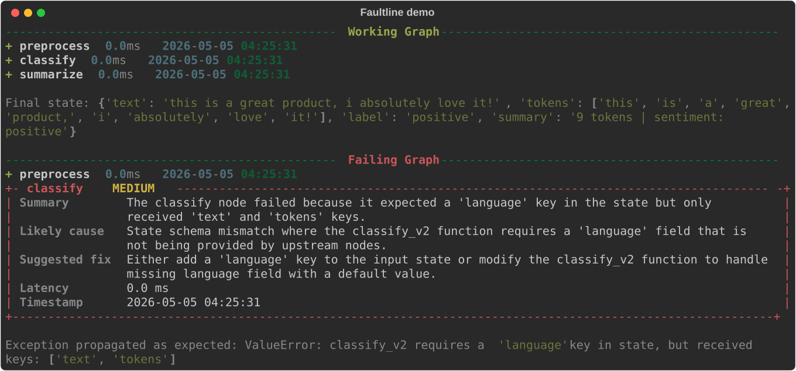

# Faultline

Faultline is a lightweight execution tracer for [LangGraph](https://github.com/langchain-ai/langgraph) that captures every node run to SQLite and uses Claude to generate structured root-cause reports the moment a node throws. Wrap a node with `wrap_node`, and you get latency tracking, persistent trace history, and an AI-authored failure report (summary, likely cause, suggested fix, severity) printed to your console without changing how the node behaves from LangGraph's perspective.



## Why

LangGraph stack traces tell you _where_ a node failed. Faultline tells you _why_, in plain language, without leaving the terminal. Every trace is persisted to SQLite so you can query past runs, compare failures across nodes, and build dashboards on top of real execution history.

## Changelog

**1.1.0**
- Analysis failures no longer mask the node's original exception.
- Default model updated to `claude-sonnet-5-5`; override with `FAULTLINE_MODEL`.
- More robust parsing of Claude's JSON reply (code fences, extra prose).
- Tracer deduplicated; DB initialised in `wrap_node` rather than at import time.
- New analyzer and reporter tests; added `.claudeignore`.

## Prerequisites

- Python 3.11+
- An Anthropic API key exported as `ANTHROPIC_API_KEY` (a `.env` file at the project root works)

## Installation

```bash
pip install -r requirements.txt
```

Then copy `.env.example` to `.env` and fill in your key:

```bash
cp .env.example .env
```

```
ANTHROPIC_API_KEY=sk-ant-...
FAULTLINE_DB_PATH=faultline.db   # optional, defaults to ./faultline.db
FAULTLINE_MODEL=claude-sonnet-5-5   # optional, Claude model used for analysis
```

## Quickstart

Wrap any LangGraph node with `wrap_node` and build your graph as usual:

```python
from langgraph.graph import StateGraph, END
from faultline import wrap_node

def classify(state):
    ...

graph = StateGraph(MyState)
graph.add_node("classify", wrap_node("classify", classify))
graph.set_entry_point("classify")
graph.add_edge("classify", END)
graph.compile().invoke({"text": "hello"})
```

On every successful node run, Faultline writes a trace row to SQLite and prints a one-line success indicator. On a failure, Faultline records the trace, calls Claude to analyze the error in context, persists the structured report, and prints a Rich panel with the diagnosis, then re-raises the original exception so your graph's error semantics are preserved. Analysis is best-effort: if the Claude call fails (missing key, network error), Faultline prints a notice, still records the trace, and re-raises your node's original exception, never the analysis error.

To see it end-to-end, run the included demo:

```bash
python examples/example_graph.py
```

The demo runs two graphs back-to-back: a working sentiment-classification graph and a deliberately broken one whose `classify` node raises a `ValueError`, exercising the full Claude-powered failure-report path.

## Modules

- **`faultline/db.py`** — SQLite layer. Owns the `traces` and `failure_reports` tables and is the only module that issues SQL. Exposes `init_db`, `insert_trace`, `insert_failure_report`, and read helpers (`get_trace`, `get_recent_traces`, `get_traces_for_node`).
- **`faultline/tracer.py`** — Node wrappers. `wrap_node(name, fn)` returns a transparent wrapper (sync or async, preserved via `inspect.iscoroutinefunction`) that records timing, persists every run, and on exception calls `analyzer` and `reporter` before re-raising.
- **`faultline/analyzer.py`** — Claude integration. Sends the failed trace to Claude with a stable system prompt (warmed via `cache_control: ephemeral`) and parses the JSON response (tolerating code fences or surrounding prose) into a `{summary, likely_cause, suggested_fix, severity}` report, which is then written to SQLite.
- **`faultline/reporter.py`** — Console output. Uses Rich to render a per-node success line and a severity-coded failure panel (green/yellow/red/critical) with summary, cause, fix, latency, and timestamp.

## Tests

```bash
pytest
```

Twenty-one tests across `tests/test_db.py`, `test_tracer.py`, `test_analyzer.py` and `test_reporter.py` cover the SQLite round-trip, success/failure persistence, sync and async wrappers, input-state immutability, original-exception preservation (including when analysis itself fails), JSON response parsing, and console rendering. The Claude client is stubbed, so the suite runs offline and costs nothing.

## Project layout

```
faultline/
├── faultline/
│   ├── __init__.py      # exports wrap_node
│   ├── tracer.py
│   ├── db.py
│   ├── analyzer.py
│   └── reporter.py
├── examples/
│   ├── example_graph.py
│   └── render_demo.py   # regenerates assets/demo.svg
├── tests/
│   ├── conftest.py
│   ├── test_db.py
│   ├── test_tracer.py
│   ├── test_analyzer.py
│   └── test_reporter.py
├── assets/
│   └── demo.svg
├── requirements.txt
├── .env.example
└── README.md
```
